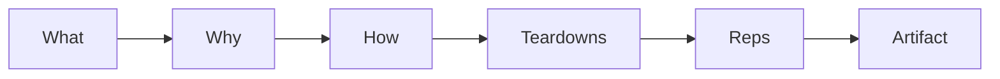

<!-- presentation:start -->
<p align="center"></p>

**Live:** https://hustlersfellowship.com

## What it is

The site and source of hustlersfellowship.com.

## Why it exists

Interviews reward proof you can ship. Almost nobody teaches that way.

## How it works



## What's inside

| Part | What |
|---|---|
| **Reach** | 500+ people read and studied it |
| **Validation** | 20+ professionals reviewed it |
| **Courses** | Build Live Products and AI Product Management |

**Stack:** HTML, JavaScript

---

Built by [Rohit Swerashi](https://github.com/therohitji), Founder & CEO of [GeniOS](https://thegenios.com).
<!-- presentation:end -->

## Full documentation

# The Hustlers Fellowship

Build-first AI courses by **Rohit Swerashi**, founder of GeniOS. Live at **[hustlersfellowship.com](https://hustlersfellowship.com)**.

Practical field guides, not theory, that turn into a real portfolio and a real product. This repository is the full Hustlers Fellowship site: the landing page and both courses, each generated into a single self-contained HTML file you can open in any browser.

## Courses

| Course | What it does | Read it | Source repo |
|--------|--------------|---------|-------------|
| **Build Live Products (2026)** | From a raw problem to a live product with real users, in about 4 weeks | [hustlersfellowship.com/buildliveproducts](https://hustlersfellowship.com/buildliveproducts) | [therohitji/build-live-products](https://github.com/therohitji/build-live-products) |
| **AI Product Management (2026)** | Become a hire-ready AI PM by building, not memorizing | [hustlersfellowship.com/aipm](https://hustlersfellowship.com/aipm) | [therohitji/ai-pm-2026](https://github.com/therohitji/ai-pm-2026) |

Each course also lives in its own standalone repository (linked above). This repo is the combined site that bundles both for the live deployment.

## Repository layout

```
.
├── index.html                  # the Hustlers Fellowship landing (course catalog)
├── favicon.svg
├── deploy.sh                   # one-shot deploy: rebuild the courses and publish the site
├── ai-pm-2026/                 # AI Product Management course (sources + built HTML)
└── build-live-products-2026/   # Build Live Products course (sources + built HTML)
```

Each course folder holds the same small build system:

```
<course>/
├── <course>-master.html   # the generated, ready-to-read course (single file)
├── build.py               # stitches the course together
├── shell.html             # the app shell: all CSS and the reader engine
├── course_map.json        # the curriculum: chapter and lesson titles, in order
├── chapters/              # lesson content, one file per chapter (chNN.js)
└── BUILD_GUIDE.md         # authoring rules and the build pipeline
```

## How a course is built

Each course is a single static HTML file generated from its sources. No dependencies beyond Python 3.

```bash
cd build-live-products-2026 && python3 build.py   # writes build-live-products-master.html
cd ai-pm-2026 && python3 build.py                 # writes ai-pm-course-master.html
```

`build.py` reads `course_map.json` and every `chapters/chNN.js`, injects them into `shell.html`, and writes the master HTML. Never hand-edit a generated master file; all edits go in `chapters/` or `shell.html`.

## The site

The landing page lists the courses and links to each at a short, shareable URL (`/buildliveproducts`, `/aipm`). Everything is static: the site is just these HTML files served from the web root, so there is no server-side build step. A site-wide ribbon at the top of every page announces what is newly live.

## Credits

Built by **Rohit Swerashi**, founder of GeniOS, for the Hustlers Fellowship. Free to read and learn from. Please do not repackage or resell the content.
