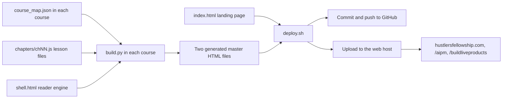
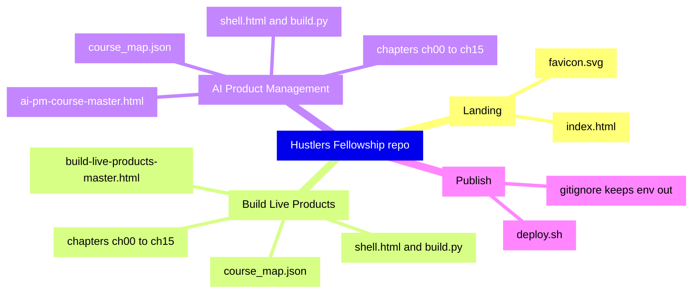

<!-- presentation:start -->
<p align="center"></p>

## Summary

The Hustlers Fellowship is a free, build-first site of AI courses by Rohit Swerashi. This repository is the full site: a landing page plus two complete courses, Build Live Products and AI Product Management, with 109 lesson entries, 240,498 words of lesson text, 113 hand-drawn SVG figures, 190 self-grading quiz blocks and 20 real product teardowns. Each course is generated from plain source files by a 94-line Python script into one self-contained HTML file, and a single shell script rebuilds, pushes and uploads the whole site. The result is three static pages with no server and no signup.

## At a glance

| Fact | Measured value |
|---|---|
| Courses live | 2 (Build Live Products, AI Product Management) |
| Courses announced as coming soon on the landing page | 2 (AI Program Manager, AI Full-Stack) |
| Chapter entries across both courses | 32 (16 each, numbered 00 to 15) |
| Lesson entries in `course_map.json` | 109 (63 and 46) |
| Real product teardowns | 20 (10 per course) |
| Industry case sections (BLP includes its 10 teardowns) | 95 (60 and 35) |
| Words of lesson text, SVG markup excluded | 240,498 |
| SVG figures | 113 |
| Self-grading quiz blocks | 190 |
| Pages that ship | 3 (landing plus two course files) |
| Generated course files | 1,417,199 bytes and 697,541 bytes |
| Landing page | 243 lines, 18,238 bytes |
| Files in the repository | 53 |
| People who read and studied it | 500+ |
| Professionals who validated it | 20+ |
| Community members | 3,000+ |
| Events run | 15+ |
| Cost to start | Free, no signup |

## What it is

The home of the Hustlers Fellowship at hustlersfellowship.com. The landing page lists the courses as cards with chips for chapters, lessons and teardowns, and each course opens at a short URL: `/buildliveproducts` and `/aipm`. A site-wide promo ribbon at the top announces what is newly live. The repository also holds the source of both courses and the script that publishes them.

The two courses are the same engine with different content. Build Live Products takes a builder from a raw problem to a live product in about 4 weeks. AI Product Management takes someone to hire-ready for AI PM roles by building, not memorising. Each course also lives in its own standalone repository; this one bundles both for the live deployment.

## Why it was built

Reading about AI careers is easy to find and easy to forget. What changes outcomes is a shipped artifact: a live product, a portfolio piece, a rep you actually ran. The Fellowship exists to put those reps in a free, no-signup format that anyone can open in a browser, and to keep the whole thing maintainable by one person.

That second constraint drove the architecture. Long courses rot when they are one giant file edited by hand. Here, every chapter is a small source file, the curriculum is one JSON file, and the published page is generated, so a broken new chapter cannot damage a working old one.

## How it works



1. **Source per course.** Each course folder holds `course_map.json` (titles, order, a through-line per chapter), `chapters/chNN.js` (lessons as raw HTML) and `shell.html` (CSS and reader).
2. **Build.** `build.py` reads the curriculum and chapters, marks each lesson live or soon, derives progress and navigation, injects them into the shell and writes the master file.
3. **Landing.** `index.html` is one static page with the course cards, chips and links.
4. **Deploy.** `deploy.sh` rebuilds both courses, commits and pushes to GitHub, then uploads over FTP with `curl`. Credentials are read from a git-ignored `.env`.
5. **Short URLs.** Each master is uploaded as `<clean-name>/index.html`, so the live paths are `/aipm` and `/buildliveproducts`.

## What makes it different

<p align="center"></p>

| | Hustlers Fellowship | A course platform | A newsletter | A video playlist |
|---|---|---|---|---|
| Signup to start | None | Account required | Email required | None |
| Format | Two full courses, 109 lessons, in plain files | Hosted modules | Posts | Videos |
| Practice | Apply It Yourself reps and quiz blocks, 190 quizzes | Varies | None | None |
| Real cases | 20 teardowns and 95 industry cases | Varies | Varies | Varies |
| Maintenance | Edit a file, run a script, one command publishes | Platform admin | Write a post | Re-record |
| Hosting | Three static pages, no server | Vendor | Vendor | Vendor |
| Portability | Every course is one HTML file you can save | Locked in | Locked in | Locked in |

## Features

| Feature | What it is | Where it lives |
|---|---|---|
| Course catalog landing | Cards for live and upcoming courses, chips, star on GitHub and LinkedIn buttons | `index.html` |
| Two live courses | Build Live Products and AI Product Management | `build-live-products-2026/`, `ai-pm-2026/` |
| Two announced courses | AI Program Manager and AI Full-Stack cards marked coming soon | `index.html`, `.card.soon` |
| Site-wide promo ribbon | A scrolling banner announcing what is newly live, on the landing and in the AI PM reader | `.promo-ribbon` in `index.html` and `ai-pm-2026/shell.html` |
| Per-course build system | Curriculum, lessons and shell stitched into one file | `build.py` in each course, 94 lines |
| Collapsible chapter rails | Chapters as toggles with live and soon tags and a progress bar | `shell.html` in each course |
| Self-grading quizzes | 190 blocks with a revealed explanation | `bindQuiz()` in `shell.html` |
| Seven-block lessons | Same structure across every teaching lesson | `_TEMPLATE.js` in each course |
| Teardown templates | The Case Lab and Build Lab formats | `_TEMPLATE_CASE.js` in each course |
| Short shareable URLs | `/aipm` and `/buildliveproducts` | `upload()` calls in `deploy.sh` |
| One-command deploy | Rebuild, commit, push, upload | `deploy.sh`, 41 lines |
| Secrets kept out of git | `.env` is ignored | `.gitignore` |
| Favicon | A white rounded square with a black H | `favicon.svg` |

## By the numbers

<p align="center"></p>

What the 109 lesson entries are made of, both courses combined.

<p align="center"></p>

Words of lesson text, split by course and by teaching chapters versus teardown chapters.

<p align="center"></p>

Lesson entries by kind. Teaching includes each course's Start Here chapter.

<p align="center"></p>

Size of the three shipped pages, in bytes.

### The two courses side by side

| | Build Live Products | AI Product Management |
|---|---|---|
| Chapter entries | 16 | 16 |
| Lessons | 63 | 46 (45 plus Start Here) |
| Words of lesson text | 169,209 | 71,289 |
| Lines of lesson source | 10,633 | 6,650 |
| SVG figures | 64 | 49 |
| Quiz blocks | 120 | 70 |
| Industry cases | 60 | 35 |
| Teardowns | 10, 2,300 to 3,300 words each | 10, about 500 words each |
| Closing artifact | A live product and a capstone plan | A portfolio piece and a 30-day plan |

### Build Live Products, every chapter

| # | Chapter | Lessons | Words | Figures | Quiz blocks |
|---|---|---|---|---|---|
| 00 | Start Here | 2 | 1,847 | 2 | 0 |
| 01 | Understanding the Problem and the Customer | 4 | 9,786 | 5 | 8 |
| 02 | Ideation and Picking the Wedge | 3 | 8,863 | 3 | 6 |
| 03 | Validation: Will They Actually Pay | 4 | 11,628 | 4 | 8 |
| 04 | Feasibility, Pricing and Unit Economics | 4 | 12,045 | 4 | 8 |
| 05 | Positioning and Differentiation | 3 | 9,230 | 3 | 6 |
| 06 | Planning the Build | 4 | 10,814 | 4 | 8 |
| 07 | Documentation: PRD and User Journey | 3 | 8,060 | 3 | 6 |
| 08 | Prototyping: Fake It Before You Build It | 3 | 7,836 | 3 | 6 |
| 09 | The MVP: The Boring V1 | 3 | 8,368 | 3 | 6 |
| 10 | Building With AI | 5 | 13,693 | 5 | 10 |
| 11 | Execution: Ship It Live | 3 | 7,788 | 3 | 6 |
| 12 | Analytics: Instrument and Read the Truth | 4 | 10,535 | 4 | 8 |
| 13 | A/B Testing and Iteration | 3 | 8,087 | 3 | 6 |
| 14 | Launch and Grow Toward Retention | 4 | 10,858 | 4 | 8 |
| 15 | The Build Lab: 10 Real 0 to 1 Teardowns | 11 | 29,771 | 11 | 20 |
| | **Total** | **63** | **169,209** | **64** | **120** |

### The 10 Build Lab teardowns

| Lesson | Product | Angle |
|---|---|---|
| 15.1 | Cursor | Fork the Incumbent, Go AI-Native |
| 15.2 | Perplexity | Position Against a Giant |
| 15.3 | ElevenLabs | Be the Best in the World at One Thing |
| 15.4 | Granola | The Boring MVP That Does One Job |
| 15.5 | Bolt.new | Launch as Distribution, Ride the Loop |
| 15.6 | Lovable | Build With AI, Ship at Insane Speed |
| 15.7 | Deel | Run Toward the Hard, Painful Problem |
| 15.8 | Cal.com | Open Source as Wedge, and the Three Objections |
| 15.9 | Linear | Craft Is a Strategy |
| 15.10 | Replit Agent | Build the Loop AI Can Run |

### AI Product Management, every chapter

| # | Chapter | Lessons | Words | Figures | Quiz blocks |
|---|---|---|---|---|---|
| 00 | Start Here | 1 | 1,132 | 1 | 0 |
| 01 | AI System Design for PMs | 4 | 6,322 | 6 | 8 |
| 02 | Agentic Architecture for PMs | 3 | 4,471 | 4 | 6 |
| 03 | How It Works Under the Hood (DSA & Data, the smart way) | 3 | 4,310 | 3 | 6 |
| 04 | Product Research for AI | 3 | 6,719 | 3 | 6 |
| 05 | Product Analytics & AI Metrics | 2 | 4,111 | 2 | 4 |
| 06 | Product Planning & Prioritization | 3 | 6,035 | 3 | 6 |
| 07 | AI PRDs & Documentation | 2 | 3,820 | 2 | 4 |
| 08 | Cross-functional Communication | 1 | 2,137 | 1 | 2 |
| 09 | Prototyping & Vibe Coding | 3 | 5,920 | 3 | 6 |
| 10 | Prompting as a PM Skill | 2 | 3,808 | 2 | 4 |
| 11 | AI Product Improvement Loops | 2 | 4,130 | 2 | 4 |
| 12 | Customer Comms & GTM for AI | 1 | 2,087 | 1 | 2 |
| 13 | AI PM Case Interviews | 3 | 5,188 | 3 | 6 |
| 14 | Portfolio & Positioning for 2026 Roles | 3 | 5,684 | 3 | 6 |
| 15 | The Case Lab: 10 Real Product Teardowns | 10 | 5,415 | 10 | 0 |
| | **Total** | **46** | **71,289** | **49** | **70** |

### The 10 Case Lab teardowns

| Lesson | Product | Angle |
|---|---|---|
| 15.1 | Cursor | When "Cheap Per Task" Lied |
| 15.2 | Perplexity | Retrieval as the Moat |
| 15.3 | Lovable | Speed-to-Demo as a Wedge |
| 15.4 | v0 | A Narrow Wedge With Built-in Distribution |
| 15.5 | Bolt.new | In-Browser Execution as the Bet |
| 15.6 | Granola | One Workflow, Done Extremely Well |
| 15.7 | Gamma | Selling Time-to-Output |
| 15.8 | ElevenLabs | Quality Bar as the Product |
| 15.9 | Cluely | Positioning, Virality & the Ethics Line |
| 15.10 | Replit Agent | Autonomy and the Leash |

## Architecture



| Path | What it holds |
|---|---|
| `index.html` | The landing page, 243 lines |
| `favicon.svg` | The site icon |
| `deploy.sh` | Rebuild, commit, push and upload, 41 lines |
| `build-live-products-2026/` | Course 1: 23 files, 16 chapter files, 10,633 lines of lessons |
| `ai-pm-2026/` | Course 2: 25 files, 16 chapter files, 6,650 lines of lessons |
| `<course>/course_map.json` | Chapter and lesson titles, in order |
| `<course>/chapters/` | Lesson content, one file per chapter |
| `<course>/shell.html` | CSS and the reader engine |
| `<course>/build.py` | The stitcher |
| `<course>/BUILD_GUIDE.md` | Authoring rules and the pipeline |

## Tech stack

| Technology | What it does here |
|---|---|
| HTML | The landing page, the shells and every lesson |
| JavaScript | Reader engine, quizzes and navigation inside each course page |
| Python 3 | `build.py`, standard library only, one per course |
| Inline SVG | 113 hand-drawn figures, no chart library |
| CSS | One theme per shell, a maroon accent on the landing page |
| JSON | `course_map.json` per course |
| Bash and curl | `deploy.sh` publishes to the web host over FTP |
| Git | The source of truth for the site |

## Run it locally

```bash
cd build-live-products-2026 && python3 build.py
cd ai-pm-2026 && python3 build.py
```

Each command writes its master HTML file (`build-live-products-master.html`, `ai-pm-course-master.html`). Open either in a browser. `deploy.sh` is the maintainer's publish script; it needs a private `.env` with upload credentials that is not in the repository.

## Who it is for

- Builders and founders who want a free guide from raw problem to live product.
- People moving into AI product roles who want reps and a portfolio, not theory.
- Authors who want a pattern for shipping long courses as plain files, one script and three static pages.
- Communities and mentors who want to point someone to one short URL.

## FAQ

**Is the Hustlers Fellowship free?**
Yes. It is free to start and needs no signup. Both courses open instantly in a browser.

**What courses does the Hustlers Fellowship offer?**
Build Live Products (16 chapters, 63 lessons, 10 real teardowns) and AI Product Management (15 chapters, 45 lessons, 10 real teardowns). AI Program Manager and AI Full-Stack are listed on the landing page as coming soon.

**How do I become an AI product manager with this?**
Follow the AI Product Management course at `/aipm`: system design, agents, metrics, PRDs, prototyping, case interviews and a portfolio chapter with a 30-day plan.

**How do I go from an idea to a live product?**
Follow Build Live Products at `/buildliveproducts`: problem sourcing, validation, positioning, planning, MVP, building with AI, launch and a Build Lab of 10 teardowns, in about 4 weeks.

**How is the site built?**
Each course is a curriculum JSON, one JavaScript file per chapter and an HTML shell. `build.py` stitches them into one static HTML file, with Python 3 as the only requirement.

**Can I reuse the content?**
It is free to read and learn from. The repository asks that you do not repackage or resell the content.

Built by [Rohit Swerashi](https://github.com/therohitji), Founder & CEO of [GeniOS](https://thegenios.com).
<!-- presentation:end -->

## Full documentation

# The Hustlers Fellowship

Build-first AI courses by **Rohit Swerashi**, founder of GeniOS. Live at **[hustlersfellowship.com](https://hustlersfellowship.com)**.

Practical field guides, not theory, that turn into a real portfolio and a real product. This repository is the full Hustlers Fellowship site: the landing page and both courses, each generated into a single self-contained HTML file you can open in any browser.

## Courses

| Course | What it does | Read it | Source repo |
|--------|--------------|---------|-------------|
| **Build Live Products (2026)** | From a raw problem to a live product with real users, in about 4 weeks | [hustlersfellowship.com/buildliveproducts](https://hustlersfellowship.com/buildliveproducts) | [therohitji/build-live-products](https://github.com/therohitji/build-live-products) |
| **AI Product Management (2026)** | Become a hire-ready AI PM by building, not memorizing | [hustlersfellowship.com/aipm](https://hustlersfellowship.com/aipm) | [therohitji/ai-pm-2026](https://github.com/therohitji/ai-pm-2026) |

Each course also lives in its own standalone repository (linked above). This repo is the combined site that bundles both for the live deployment.

## Repository layout

```
.
├── index.html                  # the Hustlers Fellowship landing (course catalog)
├── favicon.svg
├── deploy.sh                   # one-shot deploy: rebuild the courses and publish the site
├── ai-pm-2026/                 # AI Product Management course (sources + built HTML)
└── build-live-products-2026/   # Build Live Products course (sources + built HTML)
```

Each course folder holds the same small build system:

```
<course>/
├── <course>-master.html   # the generated, ready-to-read course (single file)
├── build.py               # stitches the course together
├── shell.html             # the app shell: all CSS and the reader engine
├── course_map.json        # the curriculum: chapter and lesson titles, in order
├── chapters/              # lesson content, one file per chapter (chNN.js)
└── BUILD_GUIDE.md         # authoring rules and the build pipeline
```

## How a course is built

Each course is a single static HTML file generated from its sources. No dependencies beyond Python 3.

```bash
cd build-live-products-2026 && python3 build.py   # writes build-live-products-master.html
cd ai-pm-2026 && python3 build.py                 # writes ai-pm-course-master.html
```

`build.py` reads `course_map.json` and every `chapters/chNN.js`, injects them into `shell.html`, and writes the master HTML. Never hand-edit a generated master file; all edits go in `chapters/` or `shell.html`.

## The site

The landing page lists the courses and links to each at a short, shareable URL (`/buildliveproducts`, `/aipm`). Everything is static: the site is just these HTML files served from the web root, so there is no server-side build step. A site-wide ribbon at the top of every page announces what is newly live.

## Credits

Built by **Rohit Swerashi**, founder of GeniOS, for the Hustlers Fellowship. Free to read and learn from. Please do not repackage or resell the content.
