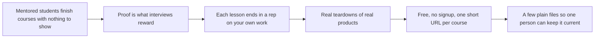
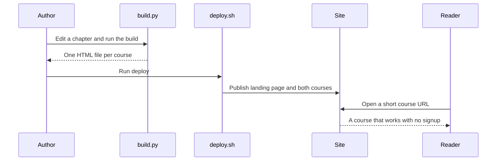

<!-- presentation:start -->
<p align="center"></p>

The Hustlers Fellowship is a set of free courses where you finish with something to show, not a certificate. This repository is the full site at [hustlersfellowship.com](https://hustlersfellowship.com): a landing page and two complete courses, [Build Live Products](https://hustlersfellowship.com/buildliveproducts) and [AI Product Management](https://hustlersfellowship.com/aipm). Two more courses are announced as coming soon.

## The problem

Students I mentored had watched every course they could find and had nothing to show. Interviews and first customers reward proof, and a finished playlist is not proof. A video can be completed without a single decision, so a person can reach the end and be no better placed.

So the Fellowship is built differently from a playlist. Every lesson ends in a rep you run on your own product or portfolio. Every course ends in a live product or a shipped artifact. Over 500 people have read it, more than 20 professionals validated it, and the community around it has over 3,000 members and has run 15 or more events.

## How I approached it



**Key decisions**

| Decision | Why | Trade-off |
|---|---|---|
| Free, with no signup | Nobody should hand over an email before they know it is useful | No accounts means no way to follow a reader's progress |
| Every lesson ends in an Apply It Yourself rep | The rep is the difference between reading and doing | Some readers will skip it |
| Real companies in every lesson and 20 full teardowns | Real decisions teach better than invented ones | Cases need re-checking as products change |
| Each course is one HTML file built from small source files | One person can maintain it, and a broken chapter cannot break the rest | A build step before publishing |
| One landing page and short URLs per course | A mentor can point someone to one link | The landing page lists courses that are not live yet, marked coming soon |

## What I built

| What | In plain words | Where |
|---|---|---|
| Landing page | Course cards, a promo ribbon and links | `index.html` |
| Build Live Products | 16 chapters, 63 lessons, 10 teardowns, raw problem to live product | `build-live-products-2026/` |
| AI Product Management | 15 chapters, 45 lessons plus a Start Here, 10 teardowns, to hire-ready | `ai-pm-2026/` |
| The build system | One 94-line script per course writes one HTML file | `<course>/build.py` |
| Publish script | Rebuilds both courses and publishes the site | `deploy.sh` |

### The two courses side by side

| | Build Live Products | AI Product Management |
|---|---|---|
| For | Founders, operators and students building a product | People moving into AI product roles |
| You finish with | A live product with real users | A portfolio artifact and a 30-day plan |
| Chapters and lessons | 16 and 63 | 15 and 45, plus Start Here |
| Teardowns | 10, long form, plus a capstone | 10, short form |
| Lesson text | about 169,000 words | about 71,000 words |

### Teardowns by name

| Course | Products |
|---|---|
| Build Live Products | Cursor, Perplexity, ElevenLabs, Granola, Bolt.new, Lovable, Deel, Cal.com, Linear, Replit Agent |
| AI Product Management | Cursor, Perplexity, Lovable, v0, Bolt.new, Granola, Gamma, ElevenLabs, Cluely, Replit Agent |

## How it works

1. Each course folder has a curriculum file, one source file per chapter and a page shell.
2. `build.py` reads them, marks each lesson live or coming soon, and writes a single HTML file.
3. `deploy.sh` rebuilds both courses and publishes the landing page and both files.
4. Each course gets its own short path, so the live addresses are `/aipm` and `/buildliveproducts`.



## What makes it different

<p align="center"></p>

| | Hustlers Fellowship | A video playlist | A course platform | A newsletter |
|---|---|---|---|---|
| Ends in | A live product or a shipped artifact | The last video | A certificate | The next issue |
| Practice | A rep in every lesson | None | Quizzes, sometimes | None |
| Real examples | 20 full teardowns, 95 company cases | Anecdotes | Varies | Varies |
| To start | Open a link | Press play | Create an account | Give an email |

## By the numbers

<p align="center"></p>

88 of the 109 lessons teach and 20 are teardowns of real products, so almost one in five is a case study.

<p align="center"></p>

About 240,000 words of lesson text, most of it in the teaching chapters of the longer course.

<p align="center"></p>

190 self-grading quizzes and 113 hand-drawn figures mean a reader is asked to check their own understanding as they go.

## What this shows

- I start from a real observation, mentored students with nothing to show, and build the product against it.
- I choose formats that remove friction: free, no signup, one short link.
- I design for maintenance. Two courses and a landing page come from a few plain files and a short script.
- Every count above was taken from the source, so none of it is estimated.

## What I would do next

- Add a way to see whether readers finish a course, without forcing a signup.
- Build the two announced courses, AI Program Manager and AI Full-Stack. They are listed as coming soon and do not exist yet.
- Expand the shorter AI PM teardowns to the depth of the Build Live Products ones.
- Keep one source of truth for each course. Both courses also live in their own repositories, so edits can drift.

## Tech stack

| Technology | What it does here |
|---|---|
| HTML | The landing page, the shells and every lesson |
| JavaScript | The reader, quizzes and navigation in each course page |
| Python 3 | `build.py`, standard library only, one per course |
| Inline SVG | 113 hand-drawn figures, no chart library |
| JSON | `course_map.json` for each course |
| Bash | `deploy.sh` publishes the site |

## Run it locally

```bash
cd build-live-products-2026 && python3 build.py
cd ../ai-pm-2026 && python3 build.py
```

Each command writes one master HTML file. Open it in a browser. `deploy.sh` is the maintainer's publish script and needs private settings that are not in the repository.

Built by [Rohit Swerashi](https://github.com/therohitji), Founder & CEO of [GeniOS](https://thegenios.com). [Book a call](https://cal.com/rohitswerashi/genios).

<details>
<summary>Full technical documentation</summary>

# The Hustlers Fellowship

Build-first AI courses by **Rohit Swerashi**, founder of GeniOS. Live at **[hustlersfellowship.com](https://hustlersfellowship.com)**.

Practical field guides, not theory, that turn into a real portfolio and a real product. This repository is the full Hustlers Fellowship site: the landing page and both courses, each generated into a single self-contained HTML file you can open in any browser.

## Courses

| Course | What it does | Read it | Source repo |
|--------|--------------|---------|-------------|
| **Build Live Products (2026)** | From a raw problem to a live product with real users, in about 4 weeks | [hustlersfellowship.com/buildliveproducts](https://hustlersfellowship.com/buildliveproducts) | [therohitji/build-live-products](https://github.com/therohitji/build-live-products) |
| **AI Product Management (2026)** | Become a hire-ready AI PM by building, not memorizing | [hustlersfellowship.com/aipm](https://hustlersfellowship.com/aipm) | [therohitji/ai-pm-2026](https://github.com/therohitji/ai-pm-2026) |

Each course also lives in its own standalone repository (linked above). This repo is the combined site that bundles both for the live deployment.

## Repository layout

```
.
├── index.html                  # the Hustlers Fellowship landing (course catalog)
├── favicon.svg
├── deploy.sh                   # one-shot deploy: rebuild the courses and publish the site
├── ai-pm-2026/                 # AI Product Management course (sources + built HTML)
└── build-live-products-2026/   # Build Live Products course (sources + built HTML)
```

Each course folder holds the same small build system:

```
<course>/
├── <course>-master.html   # the generated, ready-to-read course (single file)
├── build.py               # stitches the course together
├── shell.html             # the app shell: all CSS and the reader engine
├── course_map.json        # the curriculum: chapter and lesson titles, in order
├── chapters/              # lesson content, one file per chapter (chNN.js)
└── BUILD_GUIDE.md         # authoring rules and the build pipeline
```

## How a course is built

Each course is a single static HTML file generated from its sources. No dependencies beyond Python 3.

```bash
cd build-live-products-2026 && python3 build.py   # writes build-live-products-master.html
cd ai-pm-2026 && python3 build.py                 # writes ai-pm-course-master.html
```

`build.py` reads `course_map.json` and every `chapters/chNN.js`, injects them into `shell.html`, and writes the master HTML. Never hand-edit a generated master file; all edits go in `chapters/` or `shell.html`.

## The site

The landing page lists the courses and links to each at a short, shareable URL (`/buildliveproducts`, `/aipm`). Everything is static: the site is just these HTML files served from the web root, so there is no server-side build step. A site-wide ribbon at the top of every page announces what is newly live.

## Credits

Built by **Rohit Swerashi**, founder of GeniOS, for the Hustlers Fellowship. Free to read and learn from. Please do not repackage or resell the content.

</details>

<!-- presentation:end -->
